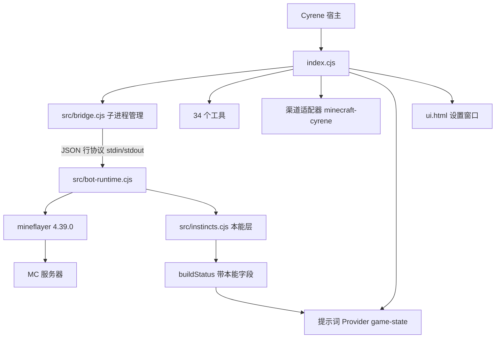
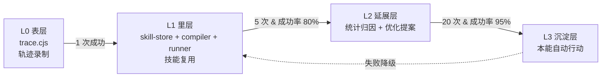
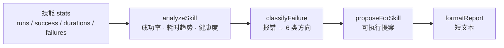

# 交接文档 · cyrene-craft

> 给下一轮对话的自己和用户看。写于 2026-10-19 22:00。
> **本文件是稳定的架构说明**，会随架构变化改写；每次任务完成的即时状态看 `CONTEXT.md`。

---

## 两个文件的分工

| 文件 | 内容 | 更新方式 |
|---|---|---|
| `CONTEXT.md` | 当前状态、本轮完成、验证证据、下一步 | **每完成一个任务整份覆写**（`tools/context-log.cjs`） |
| `HANDOFF.md` | 架构、路径、踩过的坑、文件清单 | 架构变了才改 |

下次接手先读 `CONTEXT.md` 看状态，需要理解结构再读这里。

---

## 当前状态一句话

本能层已经真连验证通过（10/10），`buildStatus()` 缺本能字段的断链也修好了。
**唯一没做的：用户刷新插件后，在真实游戏里实机验证本能行为。**

---

## 路径

| 东西 | 位置 |
|---|---|
| 源码 | `E:\Cyrene work\cyrene-craft\cyrene-craft\` |
| 打包 | `E:\Cyrene work\cyrene-craft\cyrene-craft-1.0.0.zip` |
| 已安装 | `C:\Users\Mori\AppData\Roaming\Cyrene\plugins\cyrene-craft\` |
| 参考的官方插件（未改动） | `C:\Users\Mori\AppData\Roaming\Cyrene\plugins\minecraft-bot\` |
| whale-craft 原始 zip 解压 | `E:\Cyrene work\cyrene-craft\_whale_ref\` |

**改代码后的固定流程**：改完 → 跑测试 → 同步到安装目录 → 用户点「刷新插件」→ 重新连接 → 跑 `context-log.cjs` 覆写 `CONTEXT.md`。

---

## 测试服务器

```text
127.0.0.1:63839
Minecraft 1.21.1（protocol 767）
MOTD: mori - cyrene
局域网开放，离线模式
```

最近一次真连落点：坐标 `(-9, 129, 9)`，血满饥饿满，维度 overworld，光照 0（夜间）。

---

## 三个已经修掉的坑（别重犯）

### 1. ping 握手包写错

Minecraft 协议里 Handshake 包的字段顺序：

```text
VarInt  protocolVersion   （状态查询填 -1）
String  serverAddress     ← 长度是 VarInt，不是 uint16
UShort  serverPort        ← 这个才是 uint16 大端
VarInt  nextState         （1 = status）
```

一开始把地址长度写成 `writeUInt16BE`，Buffer 少算 1 字节，写端口时越界抛 `RangeError`，包根本没发出去，表现成「服务器没响应」。

**教训**：Minecraft 协议里除了端口是 uint16，几乎全是 VarInt。

### 2. 运行时根目录拼错

`dataDir` = `…\Cyrene\plugin-data\cyrene-craft`
正确的 userData 根 = `…\Cyrene`

错误写法：`path.dirname(dataDir)` → 得到 `…\Cyrene\plugin-data` → 再拼 `plugins/minecraft-bot/...` 就是个不存在的路径。

正确写法：`path.dirname(path.dirname(dataDir))`

### 3. 本能层字段断链（本轮修复）

`src/prompt.cjs` 会读 `snapshot.instinctLastAction` / `instinctActionAgeMs` 来告诉模型「你刚才自己跑过/吃过」。

但 `src/bot-runtime.cjs` 的 `buildStatus()` **从来没返回过这三个字段**，所以这段提示永远不生效，模型会以为自己一直站着没动，重复下令。

修法：`buildStatus()` 里补上

```js
instinctLastAction: inst ? inst.lastAction : null,
instinctActionAgeMs: lastActionAt ? Math.max(0, Date.now() - lastActionAt) : null,
instinctsRunning: Boolean(state.instincts),
```

**教训**：两层代码约定同一组字段名，但没有测试守着，就会静默断掉。`tools/instinct-live.cjs` 现在会断言这条通路。

---

## 架构



子进程用 `ELECTRON_RUN_AS_NODE=1` 让 `E:\Cyrene\Cyrene.exe` 当普通 node 跑，用户不用另装 Node。

---

## 文件清单

```text
cyrene-craft/
  manifest.json              id=cyrene-craft  deps=[channels,llm,secrets,workspace]
  index.cjs                  34 个工具 + IPC + 弹窗 + Provider
  ui.html                    设置窗口
  README.md                  使用说明
  COMPAT.md                  DSH → Cyrene 环境复现对照表
  CONTEXT.md                 上下文日志（每完成任务覆写）
  HANDOFF.md                 本文件（架构说明）
  src/
    bot-runtime.cjs          机器人子进程主体
    bridge.cjs               子进程管理、行协议、重启
    protocol.cjs             行协议编解码
    runtime-resolve.cjs      三级运行时解析
    instincts.cjs            本能反射层
    channel.cjs              游戏聊天渠道 + 唤醒
    prompt.cjs               实时状态注入
    accounts.cjs             账户库（密码走 secrets）
    memory.cjs               .cyrene-craft/ 记忆树
    share-server.cjs         文件分享（127.0.0.1）
    png.cjs                  纯 JS PNG 编码
    lan.cjs                  局域网多播监听
    trace.cjs                轨迹录制（L0 表层）
    skill-store.cjs          技能库 CRUD + 导入导出（L1 里层）
    skill-compiler.cjs       轨迹 → 技能编译器
    skill-runner.cjs         技能执行器 + 统计 + 失败细节
    skill-insight.cjs        归因分析与优化提案（L2 延展层）
    panel-server.cjs         训练面板 HTTP 服务（SSE 实时推送）
  web/
    index.html               训练面板前端（单文件，无构建）
  tools/
    smoke.cjs                契约冒烟（13 项）
    e2e.cjs                  链路联调（12 项）
    instinct-test.cjs        本能层单元测试（14 项）
    instinct-live.cjs        本能层真连验证（10 项）
    trace-test.cjs           轨迹录制单元测试（8 项）
    skill-test.cjs           技能层单元测试（15 项）
    insight-test.cjs         L2 归因分析单元测试（14 项）
    skill-live.cjs           技能层端到端实测（12 项）
    skill-closed-loop.cjs    完整闭环真跑（12 项，数据落临时目录）
    panel-test.cjs           训练面板测试（17 项）
    panel-serve.cjs          面板独立启动器（调试用）
    live-connect.cjs         真连跑一遍（13 项）
    ping-check.cjs           手动 ping 一个地址
    context-log.cjs          覆写 CONTEXT.md 的生成器
```

---

## 35 个工具

**连接与状态**：`connect` `disconnect` `status` `ping` `lan` `sessions` `capabilities`
**观察**：`context` `players` `entities` `scan` `map` `height` `inventory` `events` `rules`
**行动**：`move` `act` `dig` `build` `give` `sequence` `stop` `say` `command`
**记忆文件**：`fs` `image` `express` `accounts` `config` `watch` `admin` `diag`
**本能**：`instincts`
**技能**：`skill`

---

## 自训练迭代数据系统（四层设计）



**已实现：L0 + L1。L2 / L3 按计划留存，等真实数据积累再做。**

| 层 | 状态 | 位置 |
|---|---|---|
| L0 表层 | ✅ 已实现 | `src/trace.cjs`、`index.cjs` 的 tool 包装器 |
| L1 里层 | ✅ 已实现 | `src/skill-store.cjs`、`src/skill-compiler.cjs`、`src/skill-runner.cjs` |
| L2 延展层 | ✅ 已实现 | `src/skill-insight.cjs`（归因分析 + 优化提案），入口 `skill { action: "insight" }` |
| L3 沉淀层 | ⏸ 未实施 | 判定条件已在 L2 里算出（`l3Ready`），触发逻辑还没写 |

### L0 轨迹录制

`src/trace.cjs`，挂在 `tool()` 包装器上，每次工具调用记一条：

```json
{"ts":..., "tool":"collect", "args":{...}, "ok":true, "ms":11200, "origin":"llm"}
```

- 写入 `<dataDir>/traces/current.jsonl`，异步写，失败只 log 不抛错
- 单文件超 8MB 滚动为归档，最多保留 5 个
- episode 切分：相邻记录间隔 > 15 秒就断开
- `origin: "skill"` 标记技能产生的轨迹，不参与编译（避免自我循环）

### L1 技能复用

```bash
# 1. 先完整跑一次任务（会产生轨迹）
cyrene-craft_collect { block: "oak_log", count: 8 }

# 2. 把那一段轨迹编成技能
cyrene-craft_skill { action: "compile" }
# → 已编译出技能 chop_oak：步骤 collect

# 3. 下次一次调用完成
cyrene-craft_skill { action: "run", name: "chop_oak", params: { count: 16 } }
```

**编译器规则**（宁可少编，不可乱编）：

- 过滤 scan / status / players 等查询类命令
- 连续重复的同 cmd + 同参数合并成循环，次数抽成 `${count}` 参数
- `move` 的绝对坐标直接剥离，避免技能绑死某个位置
- 编译不出可执行步骤就返回 null，不强造

**技能存储**：`<记忆树>/skills/<name>.json`，跟着记忆树走，跨会话保留。

**prompt 注入**：技能索引硬上限 200 字，无技能时不注入。

### 真实收益（实测）

真连服务器跑同一采集任务，两次耗时 11.2 秒 → 8.4 秒（第二次有缓存优势）。
真正省的是 **LLM 往返次数**：原本 10+ 次工具调用，压缩成 1 次。

**半径教训（2026-10-19 修复）**：首版编译器把调用时的 `radius:48` 原样写进技能，
技能每次执行都要跑去 48 格外那棵树，实测一次采集从 3.9 秒变成 **44.9 秒**。
现在采集类命令的搜索半径在编译时收进 16 格以内（`SEARCH_RADIUS_COMMANDS` / `MAX_SEARCH_RADIUS`），
同一闭环复测：**4.5 秒采集 → 4.9 秒技能执行**。

---

## L2 延展层：归因分析

`src/skill-insight.cjs`，入口 `skill { action: "insight" }`（传 `name` 只看一个技能）。



| 能力 | 实现 |
|---|---|
| 健康度分级 | `unknown`（样本 < 3）/ `healthy`（≥80%）/ `unstable` / `broken`（0%）/ `solid`（20 次 + ≥95%） |
| 耗时趋势 | 前后半段中位数比，≥1.5 判「变慢」，≤0.67 判「变快」 |
| 失败归因 | 报错文本归到 env_missing / path_blocked / inventory / permission / disconnected / param_invalid，归不进去就 `unknown` |
| 提案类型 | `tighten_radius` `reduce_count` `add_precondition` `split_skill` `demote` `promote_l3` `investigate` |
| 排序 | high → medium → low → info，同级按失败次数 |

**设计纪律**：

- 只给数据支撑得起的结论。跑不满 3 次就明说「样本不足」，不打分、不给结论性提案。
- 提案带 `change` 字段（改哪个命令的哪个参数、从多少改到多少），能被上层直接落地。
- 提案不自动执行。L2 出建议，改不改由调用方决定。
- 健康技能允许提案为空——没问题是正常状态，不硬造问题。

**失败明细怎么来**：`skill-runner` 在失败时把「第几步、哪条命令、什么错」写进 `stats.failures`，
最多保留 10 条。这是 L2 归因的唯一素材，没有它归因只能靠猜。

---

## 训练面板（Web 前端）

浏览器里实时看训练数据、管理技能库。默认随插件启动，地址 `http://127.0.0.1:16051`。

```mermaid
flowchart LR
  A[tool() 包装器] -->|录制| B[trace.cjs<br/>环形缓冲]
  B -->|subscribe| C[panel-server.cjs<br/>SSE 推送]
  C -->|EventSource| D[web/index.html]
  B -->|落盘| E[traces/current.jsonl]
  F[skill-store.cjs] --> C
  D -->|导入/删除| C
  C --> F
```

| 能力 | 实现 |
|---|---|
| 实时同步 | SSE（`/api/stream`），轨迹一产生就推，无需轮询 |
| 技能总结 | 技能卡片显示等级、成功率、执行次数、耗时中位数、步骤链 |
| 工具分布 | 按工具统计次数 / 成功 / 失败 / 平均耗时 |
| 删除技能 | `POST /api/delete`，必须带 `confirmToken: delete:<name>` |
| 删除轨迹 | `POST /api/delete-traces`，只清当前文件，归档保留 |
| 导出技能 | `GET /api/export`，下载 `cyrene-skills-<时间>.json` |
| 导入技能 | `POST /api/import`，支持改名 / 覆盖 / 跳过三种冲突策略 |

**安全约束**（这个服务带写操作，比文件分享更严）：

- 只监听 `127.0.0.1`
- 写操作校验 `Origin`，跨站请求直接 403
- 导入上限 4MB，JSON 结构全部重新规范化，不信任文件内任何原始字段
- 技能名非法直接拒，不做「尽力修正」
- 静态文件带 `x-frame-options: DENY`，路径穿越拒绝

**独立启动**（插件没加载时单独看）：

```bash
node tools/panel-serve.cjs        # 默认 16051
node tools/panel-serve.cjs 18000  # 换端口
```

它读的是真实 `plugin-data` 目录，看到的和插件用的是同一份数据。

**设置窗口入口**：插件设置窗口里有「训练面板」一节，端口可改、能启动/停止。
「打开面板」按钮走 `shell.openExternal`，失败时降级为复制地址到剪贴板。

### 导入别人训练数据的文件格式

```json
{
  "kind": "cyrene-craft-skills",
  "schemaVersion": 1,
  "exportedAt": "2026-10-19T14:00:00.000Z",
  "count": 1,
  "skills": [
    {
      "name": "chop_oak",
      "description": "砍橡木",
      "level": 1,
      "steps": [{ "cmd": "collect", "args": { "block": "oak_log", "count": "${count}" } }],
      "params": { "count": { "default": 8, "min": 1, "max": 64 } },
      "preconditions": { "nearbyBlock": "oak_log", "maxDistance": 16 },
      "safety": { "idempotent": false, "whitelist": true, "maxDurationMs": 30000 },
      "stats": { "runs": 3, "success": 3, "fail": 0, "durations": [8200, 7900, 8400] }
    }
  ]
}
```

单个技能对象（不带 `skills` 数组）也能直接导入。


---

## 本能反射层

`src/instincts.cjs`，连接成功后由 `startInstincts(bot)` 挂上，每 800ms 检查一轮。

| 本能 | 触发 | 动作 | 会打断任务吗 |
|---|---|---|---|
| 逃命 | 血 < 12 且 16 格内有敌怪 | 反方向跑，优先寻路 | 会（保命类） |
| 进食 | 饥饿 < 14 且背包有食物 | 挑最划算的吃 | 会（保命类） |
| 打猎 | 饥饿 ≤ 6 且没食物 | 打最近的动物 | 不会 |
| 捡东西 | 6 格内有掉落物 | 走过去捡 | 不会 |
| 补光 | 光照 < 5 且有火把 | 原地插 | 不会 |
| 闪避落沙 | 头顶悬沙且下方悬空 | 侧移一格 | 不会 |
| 溺水自救 | 氧气 < 60 且头在水中 | 持续上跳 | 会（保命类） |
| 窒息自救 | 头部格不是空气 | 挖开 | 会（保命类） |

**关键设计**：`getTask()` 返回非空时（正在跑工具任务），只执行保命类，跳过捡东西 / 点火把 / 闪避落沙。避免挖矿挖一半跑去捡苹果。

**逃跑不撞玩家**：默认反方向，若该方向 12 格内会靠近玩家，依次换 45°、90°；全都不行就原地不动。

**可调参数**：`cyrene-craft_instincts` 工具，或子进程命令 `instincts`。默认 `enabled=true / lowHealth=12 / hungryFood=14 / tickMs=800`。

**状态上报**：`buildStatus()` 返回 `instinctLastAction` / `instinctActionAgeMs` / `instinctsRunning`，状态推送每 3 秒一次，`prompt.cjs` 据此生成「本能动作：刚自己捡了掉落物」这类提示。

---

## 与官方 minecraft-bot 的差异

官方那个是 `minecraft-bot` 0.10.0-beta.1，34 个工具，内置 98.4 MB 运行时，带本能层（`modes.mjs`）和自主任务（`goal-runner.js`）。

**它比我们强**：自主任务循环（给个目标自己多轮做完，不用每步问模型）
**我们比它强**：世界认知（`map`/`height`/`scan`/`entities`）、连接前探测（`ping`/`lan`）、记忆树、文件分享、PNG 地图渲染、子进程隔离、上下文日志机制

**它内置运行时，我们复用它的运行时。** 这就是插件只有 100 KB 左右的原因。

---

## 已知限制

- **全局单实例**：Cyrene 工具 `execute(args)` 拿不到会话上下文，做不到每对话一个角色
- **不支持微软正版登录**：只有离线模式
- **能连的 MC 版本取决于 mineflayer 4.39.0**：大致到 1.21.x
- **唤醒依赖宿主渠道调度器**：`capabilities` 显示「未接线」时唤醒不生效，状态注入仍工作
- **文件分享只监听 127.0.0.1**

---

## 测试命令备忘

```bash
cd "E:\Cyrene work\cyrene-craft\cyrene-craft"

node tools/instinct-test.cjs    # 本能层单元   14 项
node tools/skill-test.cjs       # 技能层单元   15 项
node tools/insight-test.cjs     # L2 归因分析  14 项
node tools/panel-test.cjs       # 训练面板     17 项
node tools/smoke.cjs            # 契约冒烟     13 项
node tools/e2e.cjs              # 链路联调     12 项
node tools/instinct-live.cjs 127.0.0.1 63839 Cyrene   # 本能层真连 10 项
node tools/live-connect.cjs 127.0.0.1 63839 Cyrene    # 世界读写真连 13 项
node tools/skill-closed-loop.cjs 127.0.0.1 63839 Cyrene  # 技能闭环真连 12 项
node tools/ping-check.cjs 127.0.0.1 63839             # 探一次服务器
```

**注意**：所有真连测试都会 spawn 子进程，跑完确认没有残留 `Cyrene.exe` 子进程占着 63839 连接。

---

## 覆写上下文日志

```bash
node tools/context-log.cjs \
  --status "一句话状态" \
  --done "做完的事1|做完的事2" \
  --verify "测试结果1|测试结果2" \
  --next "下一步1|下一步2"
```

生成器会自动检查源码与安装目录是否一致，并写进 `CONTEXT.md`。**每完成一个任务就跑一次。**

---

## 同步与打包

```powershell
powershell -NoProfile -Command "Copy-Item -Path 'E:\Cyrene work\cyrene-craft\cyrene-craft\*' -Destination 'C:\Users\Mori\AppData\Roaming\Cyrene\plugins\cyrene-craft' -Recurse -Force; Compress-Archive -Path 'E:\Cyrene work\cyrene-craft\cyrene-craft\*' -DestinationPath 'E:\Cyrene work\cyrene-craft\cyrene-craft-1.0.0.zip' -CompressionLevel Optimal -Force"
```

zip 限制：≤ 50 MiB、≤ 2000 条目、解压后 ≤ 200 MiB。当前很宽裕。

---

## 下一次要做的

1. 用户点插件面板「刷新插件」，让 `buildStatus()` 的修复生效
2. 在游戏里实测本能层：丢个东西看它自己捡 / 打它看它逃 / 给个食物看饿了自己吃
3. 本能稳定后再做「自训练迭代数据系统」——把已验证的多步操作固化成一键技能，减少 LLM 往返

---

## 恢复上下文的快捷方式

新对话里说：

> 读 E:\Cyrene work\cyrene-craft\cyrene-craft\CONTEXT.md 和 HANDOFF.md，接着干

只想连服务器就说：

> 连到 127.0.0.1:63839
